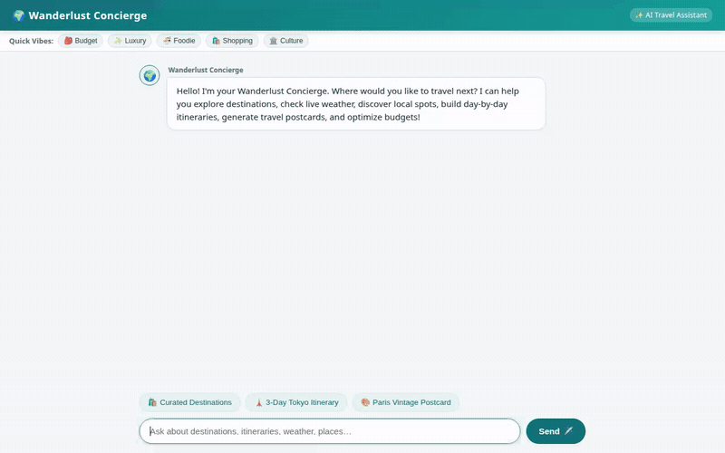

# 🌍 Wanderlust Concierge

An intelligent travel planning and concierge AI agent built with **Google Agent Development Kit (ADK)** and powered by **Gemini 2.5/3.1/3.7**. Wanderlust Concierge functions as an end-to-end travel advisor: searching destinations, retrieving live meteorological forecasts, looking up points of interest via Google Maps & Places, generating personalized itineraries and budget estimates, synthesizing vintage postcards and cinematic drone videos, and remembering traveler preferences and dietary/allergy constraints across sessions.



---

## ✨ Features & Implemented Capabilities

- **Cross-Session Memory & Allergy Management**:
  - Remembers traveler preferences, past trips, budget tiers, and critical dietary/medical allergies across conversations using **Vertex AI Memory Bank**.
  - Automatically factors recorded allergies and dietary restrictions into dining recommendations and itineraries.
- **Dynamic Catalog & Storage**:
  - Stores and retrieves curated travel destinations, attractions, and vibe metadata using **Google Cloud Firestore**.
  - Hosts generated visual and video assets on **Google Cloud Storage (GCS)** with public HTTPS delivery.
- **Live Weather & Geospatial Services**:
  - **Live Weather Forecasts**: Real-time temperature, wind speed, weather codes, and multi-day precipitation forecasts via Open-Meteo.
  - **Google Geocoding & Places (New)**: Exact coordinate lookups and nearby places searches (restaurants, shopping, entertainment, landmarks) via Google Maps Platform.
- **Generative Media**:
  - **Postcard Generation**: Custom high-resolution vintage artistic travel postcards generated with `gemini-3.1-flash-lite-image`.
  - **Drone Video Generation**: Cinematic aerial travel videos generated with Google's Omni model (`gemini-omni-flash-preview`).
- **Interactive UI (A2UI & Markdown)**:
  - Supports Google **A2UI** (Agent-to-UI) structured surface cards and rich Markdown rendering (sanitized tables, lists, and typography).
  - Fast-action suggestion chips, vibe filter tags, and image lightbox zoom modal.
- **Agent Engine Code Execution Sandbox**:
  - Safely evaluates trip calculations, currency conversions, and data transformations via `AgentEngineSandboxCodeExecutor`.

---

## 🛠️ Implemented Tools & Architecture

| Tool Name | Service / Technology | Description |
|---|---|---|
| `PreloadMemoryTool` | **Vertex AI Memory Bank** | Recalls durable user preferences and allergy history before model invocation. |
| `list_destinations` | **Cloud Firestore** | Queries destinations filtered by vibe (shopping, foodie, culture) or budget tier. |
| `get_destination_details` | **Cloud Firestore** | Fetches detailed destination guides, top sights, and average cost benchmarks. |
| `save_destination` | **Cloud Firestore** | Adds or updates custom destinations into the traveler catalog. |
| `get_destination_live_weather`| **Open-Meteo API** | Fetches live real-time weather and forecast data for any destination coordinates. |
| `geocode_address` | **Google Geocoding API** | Converts landmarks, cities, or addresses to latitude/longitude coordinates. |
| `find_nearby_places` | **Google Places API (New)** | Finds top-rated dining, attractions, and shopping around target coordinates. |
| `generate_destination_postcard`| **Gemini 3.1 Flash Lite Image** | Generates artistic travel postcards, uploads to GCS, and saves as an artifact. |
| `generate_destination_video` | **Gemini Omni Flash Preview** | Generates cinematic drone travel videos, uploads to GCS, and saves as an artifact. |
| `compose_itinerary` | **Gemini 3.7 Flash** | Builds day-by-day travel agent itineraries with morning/afternoon/evening plans. |
| `calculate_trip_budget` | **Gemini / Python Sandbox** | Calculates itemized trip cost breakdowns across lodging, food, transit, and activities. |
| `recommend_hotels` | **Gemini 3.7 Flash** | Matches lodging options tailored to the traveler's budget and location preferences. |

---

## 🏗️ Project Structure

```text
wanderlust-concierge/
├── app/
│   ├── agent.py               # ADK Root Agent, callbacks, tools, and system prompt
│   ├── fast_api_app.py        # FastAPI server integration with A2A endpoints
│   ├── a2ui_utils.py          # A2UI schema manager and response callbacks
│   └── app_utils/             # A2A protocol route handlers
├── frontend/
│   ├── main.py                # FastAPI proxy server connecting UI to Agent Runtime / ADK
│   ├── requirements.txt       # Frontend dependencies
│   └── static/
│       └── index.html         # Responsive web chat UI with Markdown, A2UI cards, and Lightbox
├── docs/
│   └── assets/
│       └── demo.gif           # Looping animated demo walkthrough
├── agents-cli-manifest.yaml   # agents-cli deployment configuration
└── pyproject.toml             # Python dependencies and package metadata
```

---

## 🚀 Getting Started Locally

### 1. Prerequisites
- Python 3.11+
- Google Cloud SDK (`gcloud`) authenticated to your GCP project
- Activated Vertex AI, Cloud Storage, Cloud Firestore, and Google Maps APIs

### 2. Environment Setup
Clone the repository and install dependencies using a virtual environment:

```bash
python3 -m venv .venv
source .venv/bin/activate
pip install -e .
```

Set up your required environment variables:
```bash
export GOOGLE_GENAI_USE_VERTEXAI=true
export GOOGLE_CLOUD_PROJECT="<YOUR_GCP_PROJECT_ID>"
export GOOGLE_CLOUD_LOCATION="us-east1"
export GOOGLE_MAPS_API_KEY="<YOUR_GOOGLE_MAPS_API_KEY>"
```

### 3. Run the Agent Locally (ADK Web)
To inspect the agent directly using the ADK Web developer UI:

```bash
adk web app
```

### 4. Run the Custom Web Frontend
To start the custom FastAPI chat interface with Markdown and A2UI support:

```bash
# In terminal 1 (start agent or ensure Agent Engine resource is configured)
# In terminal 2:
export AGENT_DIRECTORY="app"
cd frontend
python main.py
```

Open your browser to the local port indicated in the terminal (typically port 8080) to interact with Wanderlust Concierge.

---

## 📜 License
Apache License 2.0. Copyright 2026 Google LLC.
